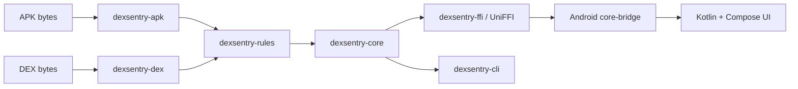

# Dexsentry

**Memory-safe Android malware static analyzer — Rust core, Kotlin UI.**

Dexsentry is a scaffold for an Android APK static analyzer. Rust will parse APK/DEX data and produce a risk report. The Kotlin + Jetpack Compose app will call Rust through UniFFI, and the desktop CLI will reuse the same Rust core.

This repository is intentionally an initial skeleton. APK and DEX parsing, rule evaluation, and malware detection are not implemented. Parser entry points return typed `Unsupported` errors; core returns an empty placeholder report.

## Architecture



Rust is used at the binary-input boundary because ownership, borrowing, and bounds-checked APIs help prevent common memory-safety mistakes when handling untrusted bytes. That does not make every parser bug impossible, and static analysis cannot prove that an APK is safe.

## Build

Requirements: stable Rust (the Android targets in `rust-toolchain.toml`), JDK 17, Android SDK platform 37, Android NDK 30.0.16248370, and `cargo-ndk` 4.1.2.

Run the Rust checks:

```sh
cargo fmt --check
cargo clippy --workspace --all-targets -- -D warnings
cargo test --workspace
```

Run the desktop CLI placeholder:

```sh
cargo run -p dexsentry-cli -- scan path/to/file.apk
```

Build native libraries and UniFFI-generated Kotlin, then assemble Android:

```sh
cargo install cargo-ndk --version 4.1.2 --locked
./scripts/build-android.sh
cd android
./gradlew ktlintCheck detekt assembleDebug
```

The Android home screen reads `version()` from Rust and displays `Dexsentry core v{version}`. Generated Kotlin and native libraries are ignored by Git and recreated by `scripts/build-android.sh`.

## Limitations

The current output is a placeholder, not a security verdict. Even after parsing and rules are implemented, static analysis cannot prove an APK is safe: behavior may depend on runtime conditions, remote content, or code that static checks do not recognize. Treat findings as evidence to review, not a guarantee.

## License

Licensed under either [MIT](LICENSE-MIT) or [Apache-2.0](LICENSE-APACHE), at your option.
