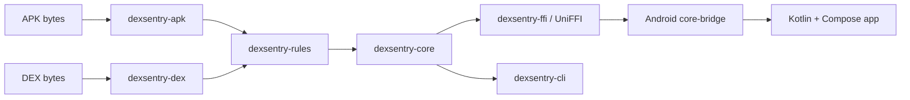

# Dexsentry architecture

Dexsentry separates untrusted binary handling from the Android interface. The Rust workspace owns APK/DEX-facing APIs and the domain report. Kotlin calls the narrow `dexsentry-ffi` boundary through generated UniFFI bindings. The desktop CLI calls the same core crate.

## Crate responsibilities

- `dexsentry-apk` will own ZIP, Android manifest, and signing-certificate parsing. Its byte-slice parser currently returns `ApkError::Unsupported`.
- `dexsentry-dex` will own DEX parsing. Its byte-slice parser currently returns `DexError::Unsupported`.
- `dexsentry-rules` defines the TOML rule model, a placeholder evaluation API, and a placeholder risk-score API.
- `dexsentry-core` owns `ScanReport`, `Finding`, and `Severity`, and currently returns an empty report with a filename and score zero.
- `dexsentry-ffi` mirrors the core types for UniFFI and translates errors across the boundary.
- `dexsentry-cli` exposes `dexsentry scan <file.apk>` on the shared core.

The dependency direction is one-way: parser crates feed rules, rules feed core, and core feeds the FFI and CLI entry points.

## Why Rust handles binary input

APK and DEX files are untrusted byte streams. Rust's ownership and bounds-checked APIs help make memory lifetime and buffer access explicit, reducing memory-safety mistakes in parsers. This is a design choice, not a claim that a Rust program is automatically safe or that static analysis detects every malicious behavior.

## Android file flow

The Android UI will copy a selected content URI into its private cache directory and pass the resulting path through UniFFI. The Rust core will open the path itself. This avoids transferring ownership of a raw file descriptor across the Kotlin/Rust boundary.

The current screens are placeholders; no file is selected or analyzed yet. See [ADR 0002](adr/0002-copy-to-cache-not-fd.md).

## Build pipeline

`scripts/build-android.sh` builds a host FFI library for UniFFI to inspect, generates Kotlin sources from it, then cross-compiles the FFI crate for arm64-v8a, armeabi-v7a, and x86_64. The Kotlin sources and `.so` files are generated build artifacts and are not committed.
